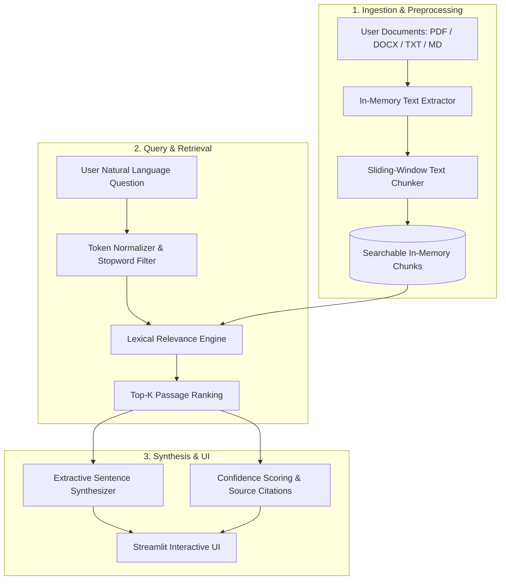

# 📚 DocuRAG — Intelligent Document Q&A & Analysis System

[](https://streamlit.io)
[](https://www.python.org/)
[](LICENSE)
[](https://github.com/taslimzafar/RAG_Based_DocumentAnalyser)

**DocuRAG** is a lightweight, local Retrieval-Augmented Generation (RAG) and document intelligence application built with Python and Streamlit. It allows users to upload documents (PDF, DOCX, TXT, Markdown), ask natural-language questions, and receive source-grounded answers with exact chunk citations and relevance scoring.

The project runs **entirely offline** without third-party LLM API keys or cloud dependencies, making it safe for confidential, proprietary, or sensitive documentation.

---

## 🌟 Key Features

- **📑 Multi-Format Parsing**: Directly ingest Adobe PDF (`.pdf`), Microsoft Word (`.docx`), Plain Text (`.txt`), and Markdown (`.md`) files in memory.
- **🧩 Configurable Sliding-Window Chunking**: Dynamically configure chunk sizes and overlapping window parameters to preserve cross-sentence context.
- **⚡ Deterministic Lexical Retrieval**: Ranks passages using a dual-factor scoring model combining **token coverage** (85%) and **token density** (15%).
- **🎯 Extractive Answer Synthesis**: Assembles answers strictly from matching sentences within high-confidence chunks, preventing hallucinations.
- **🔍 Deep Chunk Inspector**: Inspect raw token counts, chunk splits, and preview individual snippets across uploaded files.
- **📊 Evaluation & Dataset Analytics Dashboard**: Includes an interactive exploration panel with KPI metric cards, document distribution charts, and correlation analysis.
- **🕒 Session History & Fast Prompts**: Quick-action query pills and session question tracking.

---

## 🏗️ System Architecture



---

## 🖥️ UI Walkthrough

The redesigned Streamlit application is organized into 4 intuitive tabs:

1. **💬 Document Q&A**:
   - Query input with preset prompts (*Summarize main purpose*, *Key findings*, *Requirements*).
   - Styled synthesized answer card with confidence badge (High / Moderate / Weak).
   - Source excerpts accordion featuring dynamic progress bars and chunk metadata.
   - Session history to review prior questions.
2. **🔍 Chunks & Corpus Inspector**:
   - Total word count, average words per chunk, and file breakdown table.
   - Interactive chunk viewer allowing slider-based inspection of individual snippets.
3. **📊 Dataset Evaluation & Insights**:
   - Metric cards: Total evaluation rows, unique documents, mean retrieval score, mean quality score.
   - Dynamic bar charts: Rows by document type, mean quality by query type.
   - Scatter plot with color gradient for chunk word counts.
   - Interactive data table with CSV export.
4. **ℹ️ Architecture & Pipeline**:
   - Technical breakdown of the underlying parsing, chunking, and scoring algorithms.

---

## 🚀 Quick Start Guide

### Prerequisites
- **Operating System**: Windows, macOS, or Linux
- **Python**: Version 3.10, 3.11, or 3.12 installed

---

### Windows (One-Click Launch)
Simply double-click the **`run.bat`** script in the project root. It will:
1. Create a `.venv` virtual environment if not present.
2. Install all required dependencies.
3. Automatically launch the Streamlit application at `http://localhost:8501`.

---

### Manual Setup (PowerShell / Terminal)

#### 1. Clone the repository
```bash
git clone https://github.com/taslimzafar/RAG_Based_DocumentAnalyser.git
cd RAG_Based_DocumentAnalyser
```

#### 2. Create and activate a virtual environment
**Windows (PowerShell):**
```powershell
python -m venv .venv
.\.venv\Scripts\Activate.ps1
```

**macOS / Linux:**
```bash
python3 -m venv .venv
source .venv/bin/activate
```

#### 3. Install dependencies
```bash
pip install -r requirements.txt
```

#### 4. Run the application
```bash
streamlit run app.py
```
Open **`http://localhost:8501`** in your browser.

---

## 📁 Repository Structure

```text
RAG_Based_DocumentAnalyser/
├── app.py                  # Modern Streamlit UI, multi-tab layout, and dashboard
├── rag_core.py             # Core retrieval logic: parsing, chunking, lexical ranking
├── requirements.txt        # Python package dependencies
├── run.bat                 # One-click Windows launch script
├── README.md               # Documentation and architecture guide
└── data/
    ├── dataset.csv         # 500-record benchmark metadata dataset
    └── data_dictionary.csv # Description of benchmark columns and data types
```

---

## ⚙️ Core Retrieval Algorithm

The ranking engine in `rag_core.py` performs lexical relevance scoring without heavy neural models:

$$\text{Score} = 0.85 \times \text{Coverage} + 0.15 \times \text{Density}$$

Where:
- **Token Coverage**:
  $$\text{Coverage} = \frac{\sum_{t \in Q} \min(C_Q(t), C_D(t))}{|Q|}$$
  *Measures what proportion of the query terms appear in the passage.*

- **Token Density**:
  $$\text{Density} = \frac{\sum_{t \in Q} \min(C_Q(t), C_D(t))}{(|D|)^{0.35}}$$
  *Rewards passages where matching terms are concentrated rather than diluted.*

---

## 📊 Supplied Evaluation Dataset

The included `data/dataset.csv` contains 500 evaluation records across 7 metadata columns:
- `doc_id`: Unique document identifier.
- `doc_type`: File classification (`policy`, `manual`, `report`, etc.).
- `chunk_id`: Assigned chunk index.
- `word_count`: Total word length of the segment.
- `retrieval_score`: Baseline similarity metric.
- `query_type`: Classification of user intent (`factoid`, `procedural`, `summary`).
- `answer_quality_score`: Groundedness assessment metric (0.0 to 1.0).

---

## 🔮 Future Enhancements & LLM Upgrades

While designed as a deterministic local extractor, the architecture easily extends to generative LLM backends:
- **Local Neural Embeddings**: Integrate `sentence-transformers` (e.g., `all-MiniLM-L6-v2`) for hybrid dense-lexical retrieval.
- **Local Generative Models**: Connect to **Ollama** (`llama3`, `mistral`, `phi-3`) via local REST API for free-form synthesis.
- **Cloud LLM Connectors**: Optional adapters for Gemini, OpenAI, or Claude.

---

## 👤 Author

**MD Taslim**  
- **GitHub**: [@taslimzafar](https://github.com/taslimzafar)  
- **Repository**: [RAG_Based_DocumentAnalyser](https://github.com/taslimzafar/RAG_Based_DocumentAnalyser)
