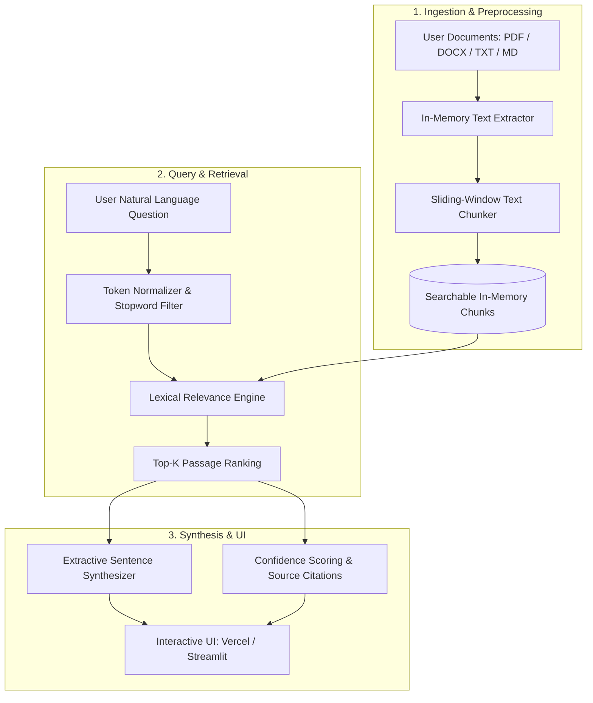

# 📚 DocuRAG — Intelligent Document Q&A & Analysis System

[](https://share.streamlit.io)
[](https://vercel.com)
[](https://www.python.org/)
[](LICENSE)
[](https://github.com/taslimzafar/RAG_Based_DocumentAnalyser)

**DocuRAG** is a lightweight, local Retrieval-Augmented Generation (RAG) and document intelligence application. It allows users to upload documents (PDF, DOCX, TXT, Markdown), ask natural-language questions, and receive source-grounded answers with exact chunk citations and relevance scoring.

The application is **dual-runtime ready**:
1. **🚀 Vercel Serverless Web App**: Native serverless deployment via `vercel.json` and `api/index.py`.
2. **🎈 Streamlit Interactive App**: Rich multi-tab dashboard via `app.py` for local use and Streamlit Community Cloud.

---

## 🌟 Key Features

- **📑 Multi-Format Parsing**: Directly ingest Adobe PDF (`.pdf`), Microsoft Word (`.docx`), Plain Text (`.txt`), and Markdown (`.md`) files in memory.
- **🧩 Configurable Sliding-Window Chunking**: Dynamically configure chunk sizes and overlapping window parameters to preserve cross-sentence context.
- **⚡ Deterministic Lexical Retrieval**: Ranks passages using a dual-factor scoring model combining **token coverage** (85%) and **token density** (15%).
- **🎯 Extractive Answer Synthesis**: Assembles answers strictly from matching sentences within high-confidence chunks, preventing hallucinations.
- **🔍 Deep Chunk Inspector**: Inspect raw token counts, chunk splits, and preview individual snippets across uploaded files.
- **📊 Evaluation & Dataset Analytics Dashboard**: Includes an interactive exploration panel with KPI metric cards, document distribution charts, and correlation analysis.
- **☁️ Zero-Config Vercel & Streamlit Cloud Support**: Ready for seamless one-click production deployment.

---

## 🏗️ System Architecture



---

## 🌐 Live Deployment Options

### Option A: Deploy on Vercel (Serverless)
This repository is configured with `vercel.json` and `api/index.py` for zero-configuration Vercel deployment:
1. Log in to [Vercel](https://vercel.com).
2. Click **Add New...** > **Project** and import this repository (`taslimzafar/RAG_Based_DocumentAnalyser`).
3. Leave all build settings as **Default** (Vercel automatically detects the Python runtime from `vercel.json`).
4. Click **Deploy**. Your app will be live on a `*.vercel.app` URL in less than a minute!

---

### Option B: Deploy on Streamlit Community Cloud (Free & Native)
1. Go to [share.streamlit.io](https://share.streamlit.io/) and sign in with GitHub.
2. Click **New app**.
3. Select your repository: `taslimzafar/RAG_Based_DocumentAnalyser`.
4. Set Main file path: `app.py`.
5. Click **Deploy**!

---

## 🚀 Local Quick Start

### Windows (One-Click Launch)
Double-click **`run.bat`** in the project root folder. It will:
1. Automatically create a virtual environment (`.venv`).
2. Install all dependencies from `requirements.txt`.
3. Launch the application locally at `http://localhost:8501`.

---

### Manual Setup (PowerShell / Terminal)

```bash
# 1. Clone repository
git clone https://github.com/taslimzafar/RAG_Based_DocumentAnalyser.git
cd RAG_Based_DocumentAnalyser

# 2. Create virtual environment
python -m venv .venv

# 3. Activate environment
# On Windows:
.\.venv\Scripts\Activate.ps1
# On macOS/Linux:
source .venv/bin/activate

# 4. Install dependencies
pip install -r requirements.txt

# 5. Run Streamlit UI
streamlit run app.py

# Or run Vercel / Flask Serverless App locally:
python api/index.py
```

---

## 📁 Repository Structure

```text
RAG_Based_DocumentAnalyser/
├── api/
│   └── index.py            # Vercel serverless Python application & modern web UI
├── app.py                  # Full-featured Streamlit interactive multi-tab application
├── rag_core.py             # Core retrieval logic: parsing, chunking, lexical ranking
├── vercel.json             # Vercel routing and deployment configuration
├── requirements.txt        # Python package dependencies
├── run.bat                 # One-click Windows launch script
├── README.md               # Documentation and architecture guide
└── data/
    ├── dataset.csv         # 500-record benchmark metadata dataset
    └── data_dictionary.csv # Description of benchmark columns and data types
```

---

## ⚙️ Core Retrieval Algorithm

The ranking engine in `rag_core.py` performs lexical relevance scoring without heavy neural models:

$$\text{Score} = 0.85 \times \text{Coverage} + 0.15 \times \text{Density}$$

Where:
- **Token Coverage**:
  $$\text{Coverage} = \frac{\sum_{t \in Q} \min(C_Q(t), C_D(t))}{|Q|}$$
  *Measures what proportion of the query terms appear in the passage.*

- **Token Density**:
  $$\text{Density} = \frac{\sum_{t \in Q} \min(C_Q(t), C_D(t))}{(|D|)^{0.35}}$$
  *Rewards passages where matching terms are concentrated rather than diluted.*

---

## 📊 Evaluation Dataset

The included `data/dataset.csv` contains 500 evaluation records across 7 metadata columns:
- `doc_id`: Unique document identifier.
- `doc_type`: File classification (`policy`, `manual`, `report`, etc.).
- `chunk_id`: Assigned chunk index.
- `word_count`: Total word length of the segment.
- `retrieval_score`: Baseline similarity metric.
- `query_type`: Classification of user intent (`factoid`, `procedural`, `summary`).
- `answer_quality_score`: Groundedness assessment metric (0.0 to 1.0).

---

## 👤 Author

**MD Taslim**  
- **GitHub**: [@taslimzafar](https://github.com/taslimzafar)  
- **Repository**: [RAG_Based_DocumentAnalyser](https://github.com/taslimzafar/RAG_Based_DocumentAnalyser)
